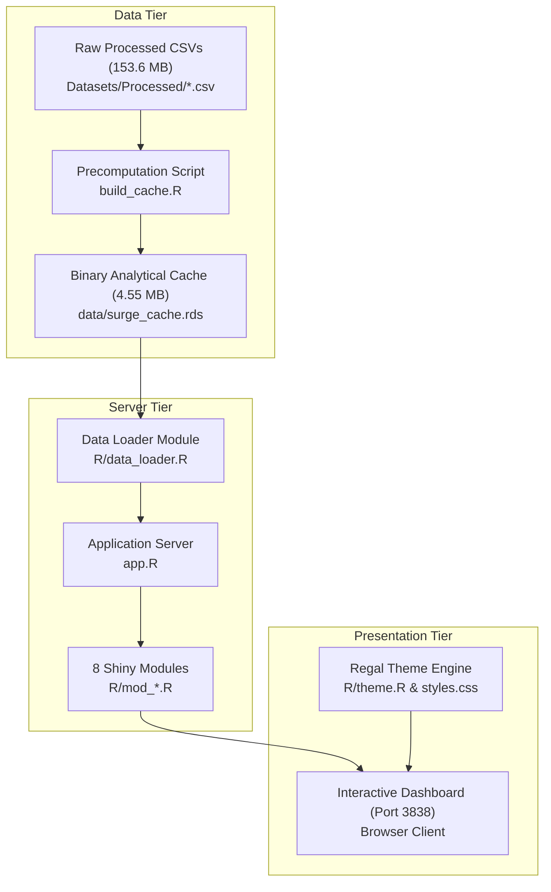

# SURGE — Gaming Industry Exposed

> **An Interactive Visual Analytics Platform for Storefront Economics, Player Reception, and Four Decades of Console Sales**

[](https://www.r-project.org/)
[](https://shiny.posit.co/)
[](https://plotly.com/r/)
[](#7-automated-regression-testing)
[]()

---

## 1. Overview & Problem Statement

The contemporary video game industry is characterized by a stark dichotomy: the hyper-abundant, long-tail digital marketplace of modern PC storefronts (exemplified by Valve's Steam) versus four decades of physical, curated retail console releases (PlayStation, Nintendo, Xbox, and legacy platforms). While industry discussions often treat game success as uniform, commercial acclaim, pricing elasticity, player engagement, and genre specialization behave fundamentally differently across hardware ecosystems and historical eras.

**SURGE** is an empirical, interactive visual analytics platform engineered to explore, analyze, and communicate these multidimensional dynamics. Built entirely in R Shiny, SURGE synthesizes over **98,000 digital titles**, **16,000 physical retail releases**, **200 hardware platforms**, and **42,000 verified cross-platform links** into a unified executive dashboard.

### Core Objectives
1. **Catalogue Specialization:** Quantify how platform holders differentiate their game catalogues by genre.
2. **Sentiment & Monetization:** Dissect community sentiment across genres and pricing models against an empirical 82% catalog median benchmark.
3. **Price vs. Acclaim:** Empirically evaluate whether higher retail prices correlate with stronger player reception.
4. **Historical Paradigm Shifts:** Contrast exponential digital proliferation against physical console retail peaks.
5. **Geographic Market Divergence:** Map regional purchasing behavior across North America, Europe, Japan, and other territories.
6. **Ecosystem Rank Correlation:** Measure Spearman rank associations across pricing, review volume, concurrent players, and playtime.
7. **Empirical Archetype Discovery:** Uncover natural groupings of PC games using Principal Component Analysis (PCA) and K-Means clustering.
8. **Cross-Source Concordance:** Link crowd-sourced campaign completion times (HowLongToBeat) with Steam review scores under strict 1-to-1 matching safeguards.

*Academic Context: This platform was developed as an advanced visual analytics project for **CSI3005: Advanced Data Visualization Techniques** at Vellore Institute of Technology (VIT).*

---

## 2. Analytical Modules & Visualizations

The platform is structured into eight focused visual analytics sections accessible via the top navigation bar:

| Module | Analytical Technique | Verified Sample Size | Primary Discovery |
|---|---|:---:|---|
| **Ecosystem Heatmap** | 2D Density Heatmap & Marginal Bar Chart | 90,815 games / 185,414 pairs | PC heavily concentrates in Strategy and Simulation, whereas Nintendo specializes in Platformers and Adventure. |
| **Player Sentiment** | Multi-Trace Violin Plots with Embedded Boxplots | 38,032 games ($N \ge 30$ reviews) | Strategy and RPGs achieve tight, high satisfaction (median 82%), while Massively Multiplayer titles show extreme polarization (median 68%). |
| **Price vs Reception** | Logarithmic Bubble Scatter with Loess Smoothing | 38,032 games ($0–$70 USD) | Base retail price exhibits virtually zero rank correlation with player satisfaction ($r_s = +0.08$); budget indies achieve acclaim parity with $60–$70 releases. |
| **Dual Timelines** | Dual-Axis Chronological Line & Bar Plots | Steam: 1997–2025<br>Console: 1980–2016 | Preserves strictly independent chronological domains: physical retail peaked in 2008 ($671.8\text{M}$ units), while digital releases exploded post-2014. |
| **Regional Sales** | 100% Stacked Bar & Tabular Breakdown | 16,446 verified games ($8,820.99\text{M}$ units) | North America drove 49.2% of global console sales; Japan generated 22.4% of all Role-Playing sales but $<1\%$ of Xbox sales. |
| **Correlations** | Spearman Rank Heatmap & Significance Matrix | 58,595 complete cases | Review volume strongly correlates with peak concurrency ($r_s = +0.72$), but pricing and discount depth exhibit near-zero association with ratings. |
| **Game Archetypes** | PCA Biplot Projection & K-Means ($K=4$) Clustering | 38,032 games $\times$ 7 dimensions | Games divide into 4 empirical clusters; 4 principal components explain **78.58%** cumulative variance. |
| **Cross-Source Bridge** | Linked Scatter Plot with Playtime & Price Filters | 42,714 verified 1-to-1 links | Compact 10–30 hour campaigns maintain high, tight community ratings (median ~87%), while 80+ hour titles exhibit widespread variance. |

---

## 3. Technology Stack & Architecture

SURGE is implemented strictly in R, relying on performant data structures and GPU-accelerated web graphics:

- **Core Framework:** [R 4.6.1+](https://www.r-project.org/) & [R Shiny](https://shiny.posit.co/)
- **Theme & Layout Engine:** [bslib](https://rstudio.github.io/bslib/) with customized Bootstrap 5 tokens and Vanilla CSS design system
- **Interactive Visualizations:** [Plotly for R](https://plotly.com/r/) & [ggplot2](https://ggplot2.tidyverse.org/)
- **Tabular Data Presentation:** [DT (DataTables)](https://rstudio.github.io/DT/) with responsive paging and column sorting
- **High-Performance Data Processing:** [data.table](https://r-datatable.com/), [dplyr](https://dplyr.tidyverse.org/), and [tidyr](https://tidyr.tidyverse.org/)
- **Multivariate Statistics & Clustering:** `stats::prcomp` (PCA) and `stats::kmeans` (MacQueen algorithm)

### Data Architecture & Execution Flow



1. **Precomputed Binary Cache (`data/surge_cache.rds`):** High-cost statistical transformations (PCA projections, K-Means clustering, Spearman correlation matrices, and platform aggregations) are precalculated and serialized into a 4.55 MB RDS file.
2. **Cold-Boot Resilience (`R/data_loader.R`):** The data loader checks for `data/surge_cache.rds`. If absent in an offline development environment containing `Datasets/Processed/`, it automatically triggers `build_cache.R` to reconstruct all aggregations. In public deployments, `data/surge_cache.rds` is provided directly to ensure instant application boot without redistributing bulk scraping datasets.
3. **Responsive Client Interaction:** UI state changes (filters, thresholds, tabs) re-query pre-partitioned in-memory data structures, providing sub-50ms reactive response times.

> [!NOTE]
> **Cache Rebuild Dependency:** The precomputed `data/surge_cache.rds` is completely sufficient for application launch and exploration. However, executing `build_cache.R` requires the offline processed CSV files in `Datasets/Processed/` (withheld from public version control for licensing compliance).

---

## 4. Analytical Methods & Key Results

### Multivariate Game Archetypes (PCA + K-Means)
- **Feature Set (7 dimensions, standardized):** `log1p(total_reviews)`, `log1p(peak_ccu)`, `log1p(playtime_forever)`, `log1p(dlc_count)`, `log1p(achievements)`, `price`, and `positive_percent`.
- **Variance Explained:**
  - **PC1 (Scale & Reach):** 39.50%
  - **PC2 (Acclaim & Sentiment):** 14.28%
  - **PC3 (Progression & DLC):** 14.12%
  - **PC4 (Base Retail Price):** 10.68%
  - **Cumulative (PC1–PC4):** **78.58%**
- **Discovered Clusters ($K=4$, $N=38,032$):**
  1. *Minimalist / Budget Barebone Catalog:* 12,387 games (32.6%) — Median price $1.99, 0 achievements, 0 peak CCU.
  2. *Engaged Mid-Tier Indies / Community Favorites:* 5,109 games (13.4%) — Median price $7.99, 222 min playtime, 83% positive rating.
  3. *Achievement-Enabled Modest Indie Releases:* 17,054 games (44.8%) — Median price $5.87, 22 achievements, 84% positive rating.
  4. *Established Commercial / High-Engagement Releases:* 3,482 games (9.2%) — Median price $19.99, 5,463 reviews, 118 peak CCU, 86% positive rating.

### Non-Parametric Rank Associations
- Evaluated on $N = 58,595$ complete pairwise cases using Spearman rank correlation ($\rho$):
  - **Total Reviews $\leftrightarrow$ Peak Concurrent Players:** $\rho = +0.72$ ($p < 0.001$, Strong Link)
  - **Playtime $\leftrightarrow$ Total Reviews:** $\rho = +0.44$ ($p < 0.001$, Moderate Link)
  - **Playtime $\leftrightarrow$ Peak Concurrent Players:** $\rho = +0.39$ ($p < 0.001$, Moderate Link)
  - **Base Price $\leftrightarrow$ Positive Sentiment (%):** $\rho = +0.08$ (Negligible Link)
  - **Discount Depth (%) $\leftrightarrow$ Positive Sentiment (%):** $\rho = -0.01$ (Zero Association)

---

## 5. Visual Identity & Regal Design System (Option C)

SURGE employs the finalized **Option C Regal Theme**, pairing deep obsidian surfaces with antique gold and velvet accents:

| Token | Hex Code | Interface Role |
|---|---|---|
| **Rich Black** | `#08090D` | Primary application background and dark canvas |
| **Royal Antique Gold** | `#C9A227` | Primary brand accent, wordmark, highlights, and active borders |
| **Royal Velvet** | `#4B236A` | Secondary brand accent, glows, and card depth |
| **Imperial Crimson** | `#9B111E` | Restrained emphasis, attention indicators, and spark details |
| **Royal Blue** | `#4169E1` | Supporting UI chrome and neutral action indicators |

- **Wordmark Typography:** Rendered in `Libre Barcode 39 Extended Text` loaded via Google Fonts, styled with natural glyph tracking (`letter-spacing: 0`) and responsive scaling.
- **Accessible Brand Navigation:** Clicking the top-left wordmark (`#brand_home_link`) from any module returns the user to the Overview executive briefing via Shiny event routing without browser reloading.

---

## 6. Installation & Launch Instructions

### Prerequisites
- **Operating System:** Windows 10/11, macOS, or Linux
- **R Runtime:** [R version 4.3.0 or higher](https://cran.r-project.org/) (tested on R 4.6.1)
- **PowerShell:** Version 5.1+ (Windows default) or bash (Linux/macOS)

### 1. Install Required R Packages
Open an R console and run:

```r
install.packages(c(
  "shiny",
  "bslib",
  "plotly",
  "ggplot2",
  "DT",
  "data.table",
  "dplyr",
  "tidyr"
))
```

### 2. Launch the Application

#### Option A: Using the PowerShell Launcher (Recommended on Windows)
Run from PowerShell in the project directory:

```powershell
.\run_surge.ps1
```
*The launcher checks for active instances on port 3838, automatically resolves Rscript via system PATH or local R installations, and opens the default browser.*

#### Option B: Launching directly via Rscript
```powershell
Rscript launch.R
```

#### Option C: Launching within an interactive R Session
```r
shiny::runApp(".", port = 3838, launch.browser = TRUE)
```

Access the dashboard in any modern web browser at:
**`http://127.0.0.1:3838`**

---

## 7. Running Regression Tests

The project includes eight automated verification and regression test suites to guarantee analytical integrity and UI consistency:

```powershell
# 1. Dataset sample sizes & schema validation
Rscript test_data.R

# 2. Mathematical model validation (PCA variance, K-Means clustering)
Rscript test_models.R

# 3. Application cold-boot and module compilation smoke test
Rscript test_smoke.R

# 4. Visualization bug-fix regression test
Rscript test_fixes.R

# 5. Regal branding (Option C) and palette preservation audit
Rscript test_regal_branding.R

# 6. UI cleanup, unnumbered navigation, and table pagination audit
Rscript test_ui_clean.R

# 7. Targeted module refinements verification
Rscript test_pass3.R

# 8. Live HTTP server listener and response test
Rscript test_server_live.R
```

*Detailed test results, exit codes, and environment signatures are validated across all 8 suites with a 100% pass rate.*

---

## 8. Data Provenance, Licensing & Caveats

### Data Provenance
1. **Steam Storefront & Player Acclaim (1997–2025):** Derived from monthly Steam Web API snapshots (FronkonGames / Kaggle community). Standardized to 98,528 games.
2. **Historical Video Game Console Sales (1980–2016):** Sourced from verified VGChartz physical retail tracking records (Gregory Smith / Gabor Vecsei). Filtered to 16,446 verified physical console releases.
3. **IGDB & HowLongToBeat Concordance:** Curated cross-platform video game database from Zenodo open academic corpus, providing hardware mappings across 200 platform families and crowd-sourced campaign durations.

### Analytical Caveats & Safeguards
- **Storefront Counts $\neq$ Financial Market Share:** In the Ecosystem Heatmap, game counts indicate catalog volume, not commercial revenue.
- **Different Eras and Modalities:** Historical console sales (1980–2016) reflect physical disc/cartridge retail sales; Steam data reflects digital PC storefront releases (1997–2025). They are juxtaposed chronologically, never merged into a single metric.
- **Review Thresholding:** Games with fewer than 30 reviews are excluded from sentiment violins and pricing regression ($N=38,032$) to eliminate 1-review shovelware distortion.
- **Concordance Matching Integrity:** The Cross-Source Bridge enforces strict 1-to-1 matching ($1.000\times$ multiplication factor); 1,851 ambiguous titles are isolated and excluded to avoid inflated counts.

### Dataset Licensing & Public Redistribution Notice
- **Academic Research Scope:** This project was developed solely as an educational visual analytics study for CSI3005 at Vellore Institute of Technology.
- **Third-Party Terms:** Upstream catalog data originates from Steam Web API scrapes, VGChartz historical retail tables, and Zenodo deposits. Because Valve's Steam Subscriber Agreement, VGChartz site policies, and commercial metadata restrictions limit public redistribution of bulk scraping dumps, raw upstream datasets (`Datasets/Original/`) and bulky processed CSVs (`Datasets/Processed/*.csv`) are retained locally and not staged for public redistribution.
- **Runtime Self-Sufficiency:** The public repository provides the pre-aggregated binary analytical cache (`data/surge_cache.rds`, 4.55 MB), which is entirely sufficient for full, clean application execution and zero-latency exploration.

---

## 9. Dashboard Interface Preview

> *Note: Placeholders below reflect core application views. Screenshots can be captured from the live application running on `http://127.0.0.1:3838`.*

```
+----------------------------------------------------------------------------------------------------+
|  ||||| SURGE  |  Overview  |  Ecosystem Heatmap  |  Player Sentiment  |  Price vs Reception ...    |
+----------------------------------------------------------------------------------------------------+
|                                                                                                    |
|  [||||| SURGE] | Gaming Industry Exposed                                                           |
|  An empirical visual analytics suite investigating modern PC digital storefronts alongside         |
|  four decades of physical console retail sales.                                                    |
|                                                                                                    |
|  +------------------+  +------------------+  +------------------+  +------------------+            |
|  | STEAM PC CATALOG |  | CROSS-PLATFORM   |  | HISTORICAL SALES |  | VERIFIED BRIDGE  |            |
|  | 98,528           |  | 99,864           |  | 8,821 M Units    |  | 42,714 Titles    |            |
|  +------------------+  +------------------+  +------------------+  +------------------+            |
|                                                                                                    |
+----------------------------------------------------------------------------------------------------+
```

---

## 10. Authors & Acknowledgments

- **Course:** CSI3005: Advanced Data Visualization Techniques
- **Institution:** School of Computer Science and Engineering, Vellore Institute of Technology (VIT)
- **Supervision:** Department of Analytics & Advanced Computing
- **Academic Disclaimer:** This repository represents student academic research in visual analytics. Valve, Steam, IGDB, HowLongToBeat, and VGChartz are registered trademarks of their respective copyright holders.
